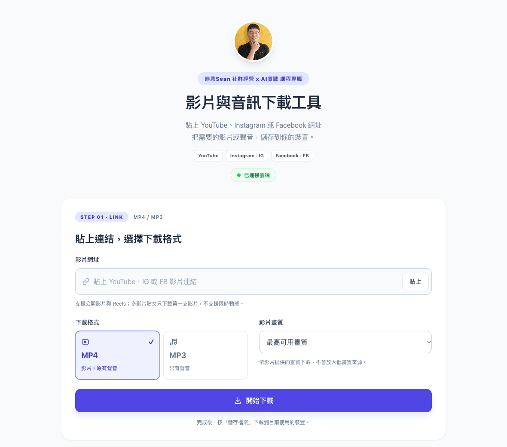

# MPDL · 熊恩Sean 影片與音訊下載工具

貼上 YouTube、Instagram（IG）或 Facebook（FB）的公開影片網址，下載 MP4 影片或轉出 320 kbps MP3。採用熊恩Sean「社群經營 x AI實戰」系列工具的淺灰底、白色卡片與靛紫色介面。

此版本由 Mac 執行下載後端，電腦與同一個 Wi-Fi 的手機可透過網頁操作。GitHub 提供原始碼；GitHub Pages 無法執行 Python、yt-dlp 與 FFmpeg，因此不是把網頁檔案放上 Pages 就能提供下載服務。

## 在 Mac 開始使用

1. 下載本儲存庫並解壓縮，或 `git clone https://github.com/SeanChen0427/MPDL.git`。
2. 準備 Python 3.10 以上、FFmpeg 與 Node.js。若使用 Homebrew：`brew install python@3.12 ffmpeg node`。
3. 雙擊 `TubeDrop/安裝元件.command`，下載並校驗官方 yt-dlp。
4. 雙擊 `TubeDrop/啟動.command`，瀏覽器會開啟工具。
5. 貼上影片網址，選 MP4 或 MP3，按「開始下載」，完成後按「儲存檔案」。

若 macOS 不允許直接開啟 `.command`，可在本專案的終端機執行 `zsh TubeDrop/安裝元件.command` 和 `zsh TubeDrop/啟動.command`。更新程式時，先在原啟動視窗按 Control+C，再重新啟動。

## 支援內容

| 平台 | 可使用的網址 |
| --- | --- |
| YouTube | 單支影片、Shorts、live、embed、youtu.be |
| Instagram | Reels、含影片的貼文、IGTV；`/reel/`、`/reels/`、`/p/`、`/tv/` |
| Facebook | Reels、Watch、`/videos/`、含影片的貼文、story.php、permalink.php |
| FB 分享網址 | 嘗試展開 `fb.watch`、`/share/r/`、`/share/v/`、`/share/p/`；若無法展開，會提示改貼完整影片網址 |

- 多影片貼文只下載第一支影片；不下載整個帳號、播放清單、限時動態或純圖片。
- MP4 可選最高可用畫質、4K、2K、1080p、720p 上限，依來源提供的格式而定。
- MP3 以 320 kbps 轉出；原始影片必須含有音軌。轉檔不會增加來源原本沒有的音質。
- 私人、需登入、會員、地區限制、平台驗證或流量限制的內容可能失敗；此版本不讀取瀏覽器登入資料。
- 目前一次處理一支影片，最多三筆執行中或排隊中的工作。

## 用手機下載

手機與 Mac 連同一個 Wi-Fi，按網頁的「複製手機連線網址」，在手機瀏覽器開啟。Mac 必須保持開機，啟動視窗不可關閉。每次啟動都會產生新的存取碼，請使用當次提供的完整網址。這是區域網路版本，尚未部署外網後端。

## 檔案與開發

- `TubeDrop/server.py`：Python 標準函式庫 HTTP 後端、網址驗證、排隊、取消與檔案提供。
- `TubeDrop/web/`：原生 HTML、CSS、JavaScript 與本機品牌圖片，無前端套件或 CDN 依賴。
- `TubeDrop/使用說明.md`：完整使用方式與限制。
- `TubeDrop/tests/test_server.py`：網址、API、權限、分享連結與工作流程測試。
- `docs/2026-11-10-下載驗證.md`：本次真實下載及瀏覽器測試紀錄。
- `docs/UI樣式.md`：系列視覺參考與設計規格。

下載檔案保留在 `TubeDrop/downloads/<工作ID>/`，不會提交到 GitHub。工作記錄在重新啟動後清除，檔案仍會保留；取消可能留下暫存檔，停止工具後可自行清理。

執行測試：`python3 -m unittest discover -s TubeDrop/tests -v`。測試會開啟本機暫時 HTTP 埠，不會連上外部平台；先完成元件安裝再執行。

預設埠號為 `8765`，可用 `TUBEDROP_PORT` 環境變數調整；也可用 `TUBEDROP_PYTHON` 指定下載元件使用的 Python 路徑。

下載元件採用 [yt-dlp 官方專案](https://github.com/yt-dlp/yt-dlp)，由安裝程式取得固定版本並校驗，不隨儲存庫散布。請下載自己擁有或已獲授權的內容。
